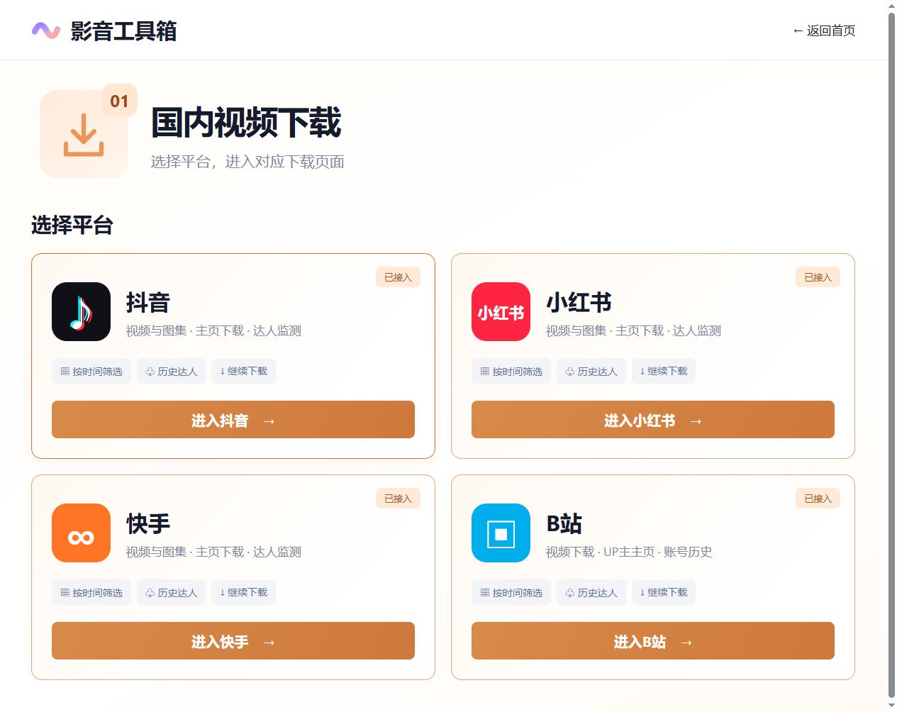
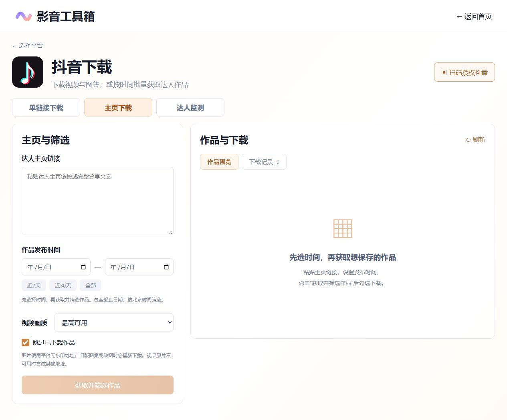
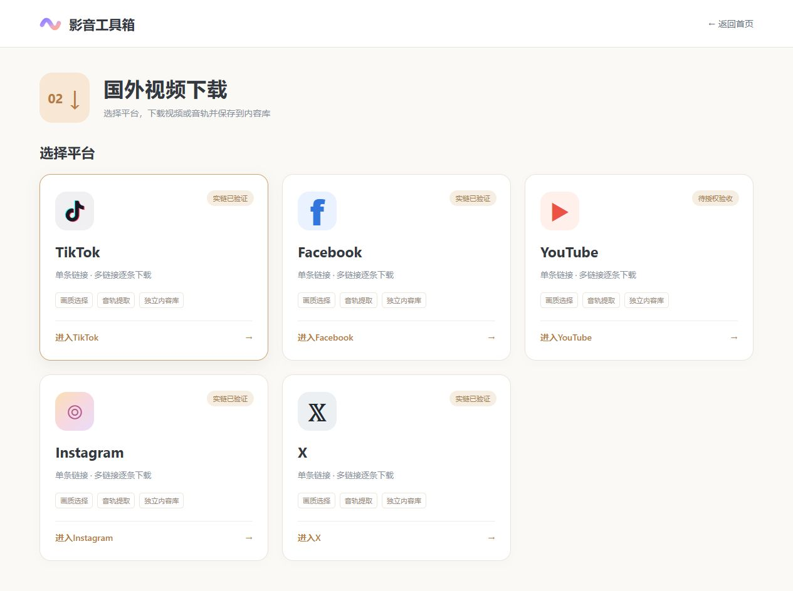
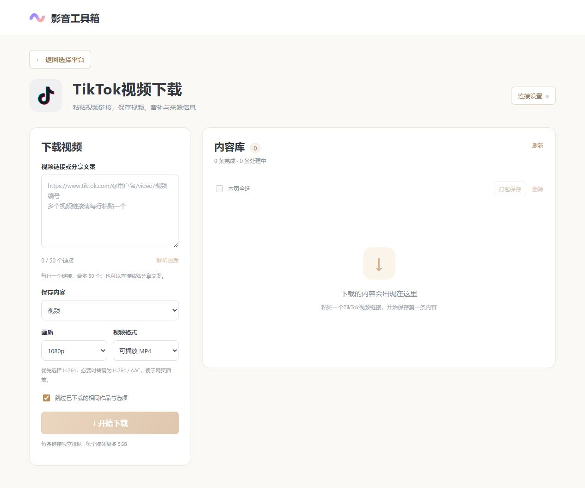
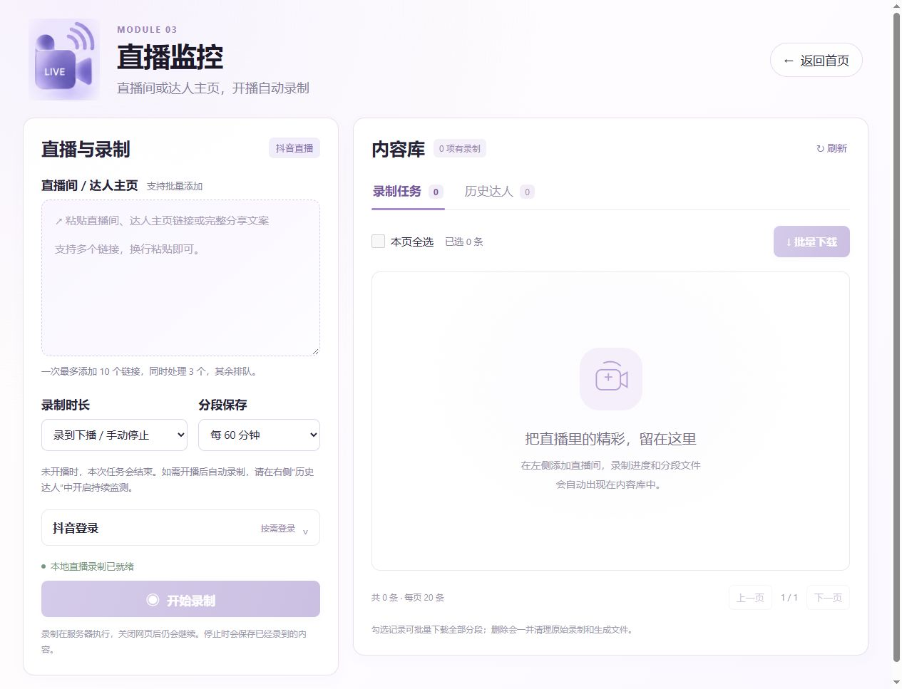
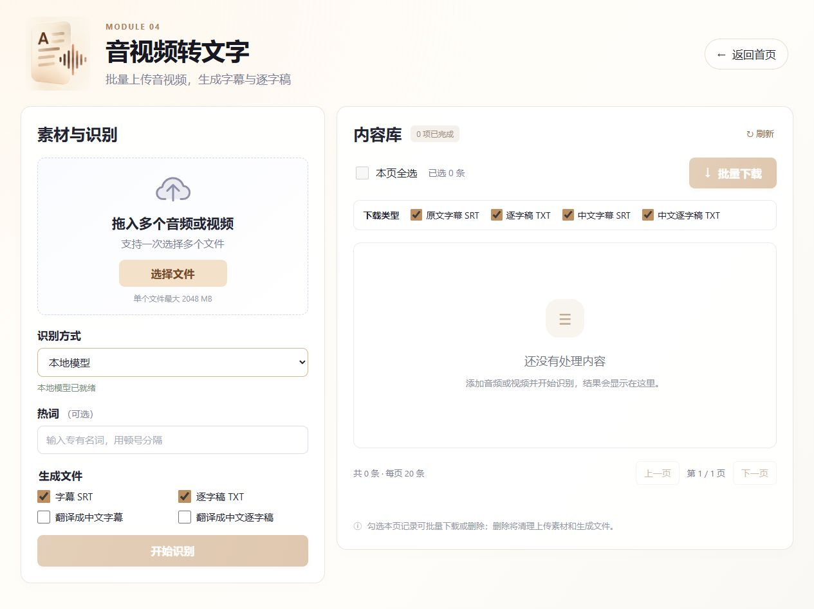
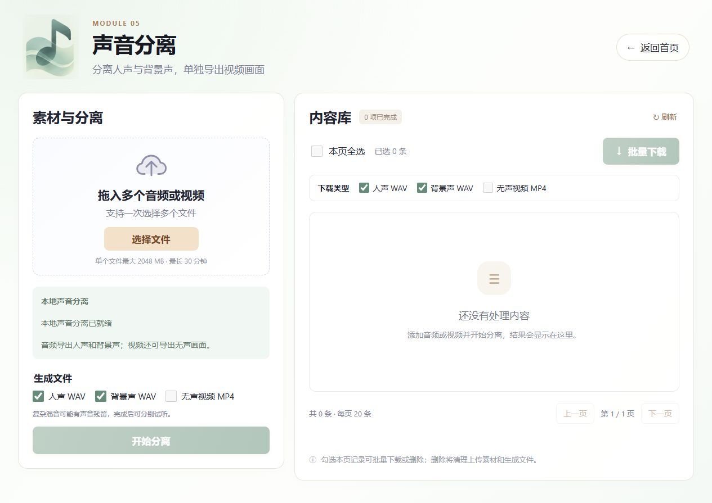
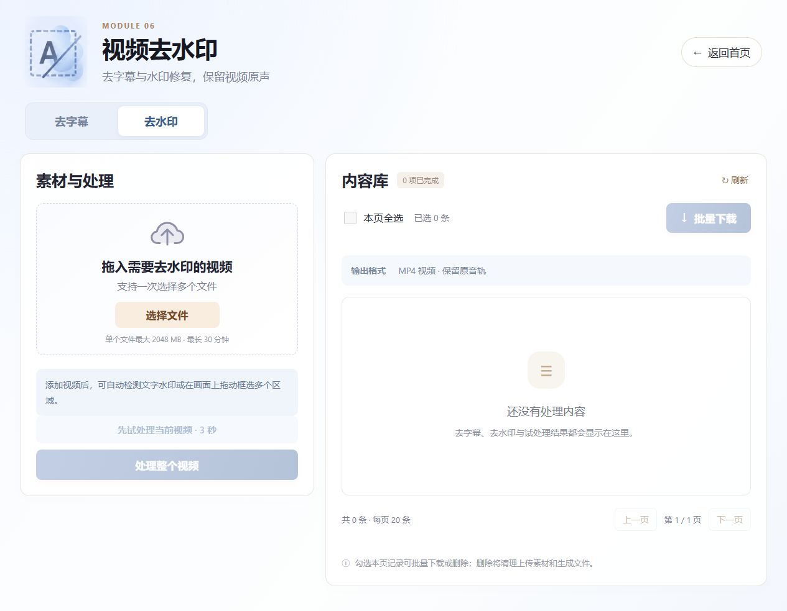
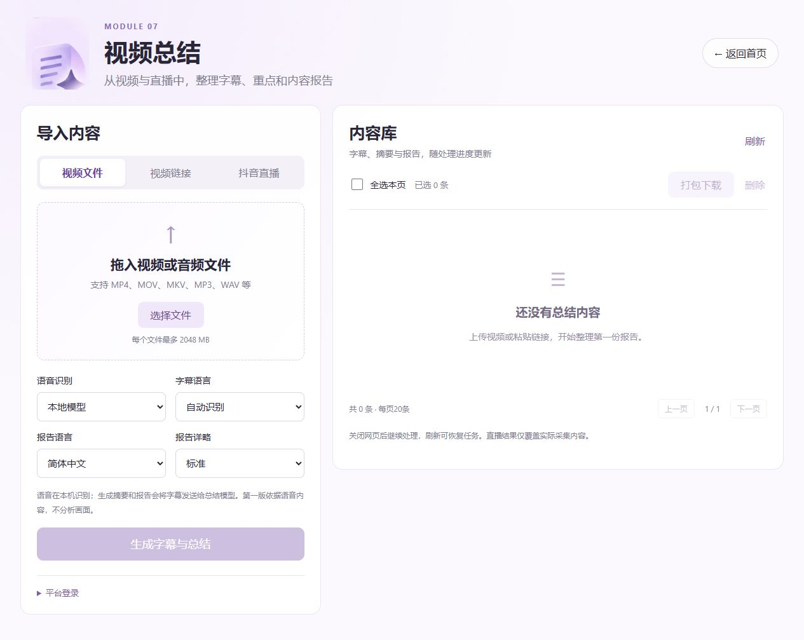
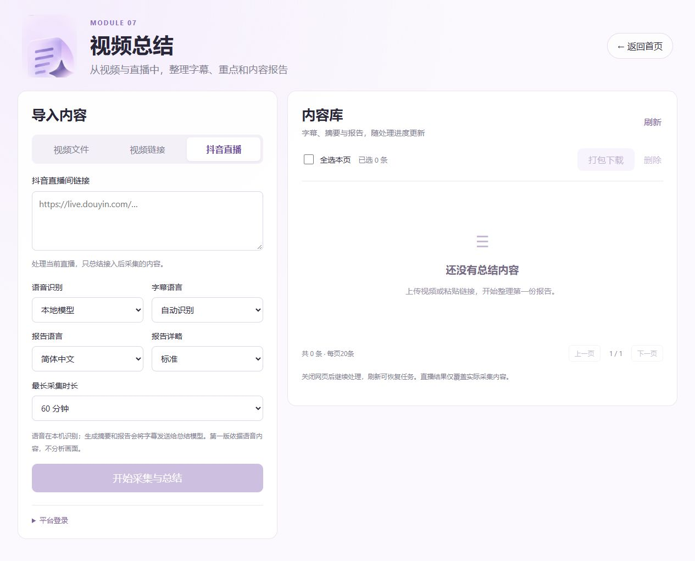

# 影音工具箱 · AV Toolkit

**v1.0.0 · 功能展示仓库**

本仓库仅展示影音工具箱的功能介绍、页面截图与版本更新，不提供源码、安装包或可运行程序。

一个面向局域网的影音处理工作台，把视频下载、直播录制、语音转写、声音分离、去字幕 / 去水印和内容总结放在同一个网页里。

在一台 Windows 电脑上启动服务，同一局域网的设备即可通过浏览器使用。七个模块独立管理任务、素材和结果；本地模型与 API 按需配置，关闭网页后，服务器上的处理任务仍会继续。

## 功能一览

| 模块 | 主要功能 | 输出 |
| --- | --- | --- |
| 01 国内视频下载 | 抖音、小红书、快手、B站；单链接、主页日期筛选、历史达人 | 视频、图集、来源信息 |
| 02 国外视频下载 | TikTok、Facebook、YouTube、Instagram、X；单条或多链接下载 | 视频、M4A 音轨、封面、来源 JSON |
| 03 直播监控 | 抖音直播录制、历史达人持续监测、开播自动录制、分段保存 | 直播录制分段 |
| 04 音视频转文字 | 批量上传、本地 Whisper / 千问 ASR、可选中文翻译 | SRT 字幕、TXT 逐字稿 |
| 05 声音分离 | 从音频或视频中分离人声与背景声 | 人声 WAV、背景声 WAV、无声 MP4 |
| 06 视频去水印 | 去字幕、文字水印检测、多区域框选、短片段试处理、同步对比 | 修复后 MP4、选区与处理报告 |
| 07 视频总结 | 文件、抖音 / 快手 / B站链接、抖音直播；带时间引用的内容归纳 | SRT、TXT、Markdown 摘要 / 报告、JSON 时间轴 |

各模块提供自己的内容库，支持任务状态、结果预览、下载和删除；具体批量操作因模块而异。素材库首页用于跳转到各模块，不合并业务文件。

## 页面与使用方式

以下为当前网页的实际截图，使用空内容库展示操作入口，不包含本机授权信息或历史任务。

### 01 国内视频下载

先选择平台，再粘贴作品链接或达人主页。支持按发布时间筛选主页作品，勾选批量下载，记录历史达人并继续下载。抖音、小红书、快手支持视频与图集；B站支持视频及音画合并。平台授权、任务与文件按平台分别保存。

### 02 国外视频下载

选择平台后粘贴视频链接或分享文案，每行一个，单批最多 50 个链接。可选择画质、视频或 M4A 音轨，以及便于网页播放的 MP4 或源编码。页面提供连接设置、去重、预览和打包保存。

目前处理单条作品与多条独立链接，不支持主页、频道、播放列表或进行中的直播批量下载。

### 03 直播监控

输入抖音直播间或达人主页，可批量创建录制任务，并设置最长录制时长与分段间隔。历史达人支持持续监测、开播自动录制和资料刷新；录制任务支持预览与批量下载。03 使用独立的抖音授权，与 01 分开管理。

单次录制遇到未开播会结束；需要等待后续开播时，在“历史达人”中开启持续监测。停止监测只停止后续自动录制，正在进行的录制需单独停止。

### 04 音视频转文字

批量上传音频或视频，选择本地模型或 API 识别，生成字幕和逐字稿。可分别勾选中文字幕与中文逐字稿；内容库支持时间轴预览、批量下载、取消和继续处理。

### 05 声音分离

上传音频或视频，在本地分离人声与背景声；视频还可单独导出无声画面。生成后可分别试听、选择下载类型并打包保存。复杂混音可能存在声音残留或细节损失。

### 06 视频去水印

“去字幕”自动检测并修复字幕区域；“去水印”支持文字候选检测与多个手动框选区域。可先处理 3 / 5 / 10 秒片段，确认效果后处理整段；原视频与结果通过同一套播放、暂停、拖动和倍速控制同步对比。生成新视频并保留原素材，原片有音轨时保留原声。

当前适合固定位置水印，不跟踪移动水印；复杂背景可能留下修复痕迹。

### 07 视频总结

上传文件、输入抖音 / 快手 / B站视频链接，或采集正在进行的抖音直播。先生成语音字幕，再通过文本模型整理重点和报告；报告引用可定位到对应字幕时间。直播在采集中产生阶段结果，结束采集后汇总已有内容。

07 与 01 共用抖音、快手、B站授权，业务任务和文件仍独立保存。当前依据语音内容生成总结，不分析画面、图表或无声演示；总结仅覆盖实际取得的内容。

## 当前范围

七个模块均已接入网页和 API。已记录的实测包括：国内平台下载样本、TikTok / Instagram / X / Facebook 单条下载、本地与 API 转写、声音分离、去水印同步预览、视频总结以及真实抖音直播总结。

仍需注意的边界：

- 小红书真实视频与图集已有下载记录；主页授权验收未通过，已有视频样本缺失音轨的原因仍待核验。
- YouTube 已接入下载流程，当前实链完整下载仍待有效授权与平台验证。
- 平台主页结果可能因授权、风控或分页上限而不完整；单条样本成功不代表完整历史可下载。
- 长时直播负载、完整局域网多客户端使用、B站多P与共享扫码交互仍需进一步实测。
- 跨模块素材导入、分块续传、磁盘配额管理、画面理解和单机打包属于后续工作。

## 版本与仓库内容

当前展示版本为 **v1.0.0**，更新记录见 [CHANGELOG.md](CHANGELOG.md)。

本仓库仅包含介绍文档和页面截图。GitHub自动生成的标签归档也只包含这些展示资料，不包含应用源码、运行环境、模型、API密钥或业务数据。
