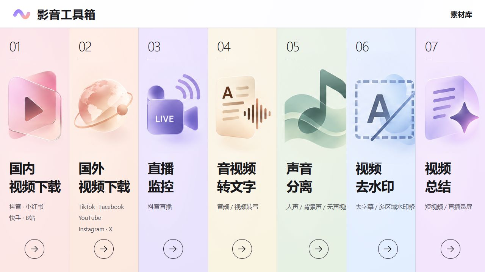

# 影音工具箱 · AV Toolkit

**v1.0.0 · 功能展示仓库**

本仓库仅展示影音工具箱的功能介绍、页面截图与版本更新，不提供源码、安装包或可运行程序。

一个面向局域网的影音处理工作台，把视频下载、直播录制、语音转写、声音分离、去字幕 / 去水印和内容总结放在同一个网页里。

在一台 Windows 电脑上启动服务，同一局域网的设备即可通过浏览器使用。七个模块独立管理任务、素材和结果；本地模型与 API 按需配置，关闭网页后，服务器上的处理任务仍会继续。

## 功能一览

| 模块 | 主要功能 | 输出 |
| --- | --- | --- |
| 01 国内视频下载 | 抖音、小红书、快手、B站；单链接、主页日期筛选、历史达人 | 视频、图集、来源信息 |
| 02 国外视频下载 | TikTok、Facebook、YouTube、Instagram、X；单条或多链接下载 | 视频、M4A 音轨、封面、来源 JSON |
| 03 直播监控 | 抖音直播录制、历史达人持续监测、开播自动录制、分段保存 | 直播录制分段 |
| 04 音视频转文字 | 批量上传、本地 Whisper / 千问 ASR、可选中文翻译 | SRT 字幕、TXT 逐字稿 |
| 05 声音分离 | 从音频或视频中分离人声与背景声 | 人声 WAV、背景声 WAV、无声 MP4 |
| 06 视频去水印 | 去字幕、文字水印检测、多区域框选、短片段试处理、同步对比 | 修复后 MP4、选区与处理报告 |
| 07 视频总结 | 文件、抖音 / 快手 / B站链接、抖音直播；带时间引用的内容归纳 | SRT、TXT、Markdown 摘要 / 报告、JSON 时间轴 |

各模块提供自己的内容库，支持任务状态、结果预览、下载和删除；具体批量操作因模块而异。素材库首页用于跳转到各模块，不合并业务文件。

## 当前范围

七个模块均已接入网页和 API。已记录的实测包括：国内平台下载样本、TikTok / Instagram / X / Facebook 单条下载、本地与 API 转写、声音分离、去水印同步预览、视频总结以及真实抖音直播总结。

## 版本与仓库内容

当前展示版本为 **v1.0.0**，更新记录见 [CHANGELOG.md](CHANGELOG.md)。

本仓库仅包含介绍文档和页面截图。GitHub自动生成的标签归档也只包含这些展示资料，不包含应用源码、运行环境、模型、API密钥或业务数据。
