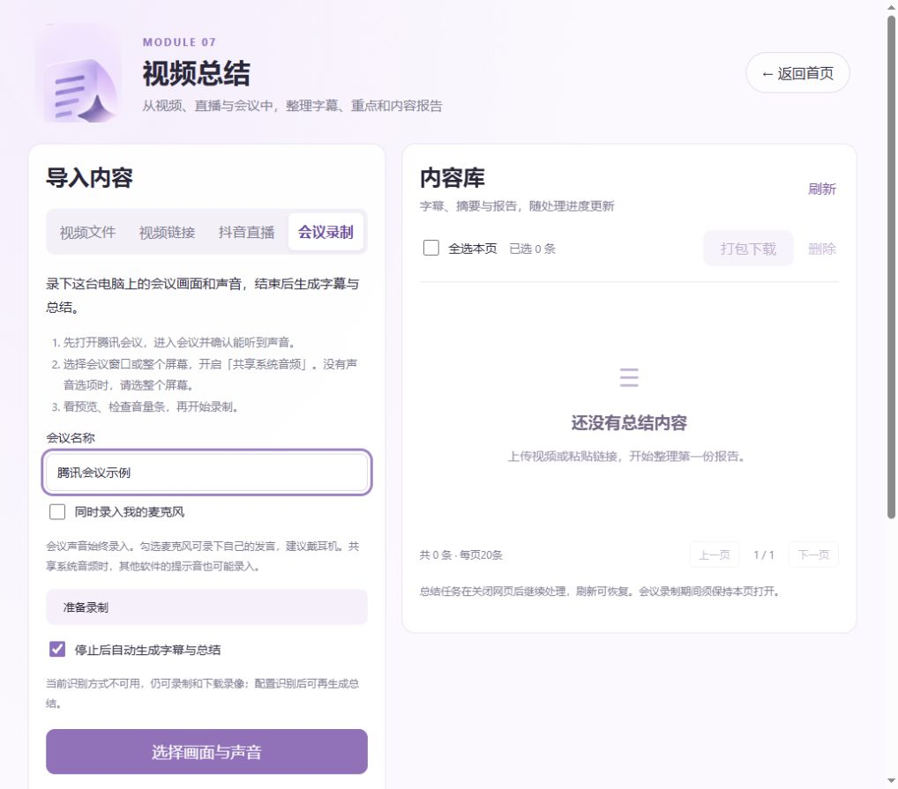

# 影音工具箱 · AV Toolkit

**v1.0.1 · 功能展示仓库**

本仓库仅展示功能介绍、页面截图和版本更新，不提供源码、安装包或可运行程序。应用源码在私有仓库维护。

一个面向局域网的影音处理工作台，把视频下载、直播录制、语音转写、声音分离、去字幕 / 去水印和内容总结放在同一个网页里。七个模块分别管理任务、素材和结果。

## 功能一览

| 模块 | 主要功能 | 输出 |
| --- | --- | --- |
| 01 国内视频下载 | 抖音、小红书、快手、B站；单链接、主页日期筛选、历史达人 | 视频、图集、来源信息 |
| 02 国外视频下载 | TikTok、Facebook、YouTube、Instagram、X；单条或多链接下载 | 视频、M4A 音轨、封面、来源 JSON |
| 03 直播监控 | 抖音直播录制、历史达人持续监测、开播自动录制、分段保存 | 直播录制分段 |
| 04 音视频转文字 | 批量上传、本地 Whisper / 千问 ASR、可选中文翻译 | SRT 字幕、TXT 逐字稿 |
| 05 声音分离 | 从音频或视频中分离人声与背景声 | 人声 WAV、背景声 WAV、无声 MP4 |
| 06 视频去水印 | 去字幕、文字水印检测、多区域框选、短片段试处理、同步对比 | 修复后 MP4、选区与处理报告 |
| 07 视频总结 | 文件、抖音 / 快手 / B站链接、抖音直播、会议画面与声音录制；带时间引用的内容归纳 | WebM 会议录像、SRT、TXT、Markdown 摘要 / 报告、JSON 时间轴 |

各模块提供自己的内容库，支持任务状态、结果预览、下载和删除；具体批量操作因模块而异。

## v1.0.1 更新

- 视频总结增加会议录制：采集画面与系统音频，可选麦克风混音，停止后保存可回放、下载的录像，并接入字幕和总结流程。
- 录制中持续上传片段，支持上传失败后重试以及意外离开后恢复已上传部分；缺少会议音轨时禁止开始。
- 移除首页「素材库」按钮及对应导航页面，各模块仍提供自己的任务和内容管理。
- 修复国外下载的竖屏画质筛选、Cookie导入和授权替换问题，完善授权失效提示。
- 改进总结报告截断后的恢复和Windows桌面启动体验。

截图来自不含私有配置、授权和任务历史的实际页面，展示的是待录制状态。录制期间需要保持网页打开；提交后的总结任务由服务器继续处理。

## 当前范围

会议录制需要新版Chrome或Edge。本机可通过localhost或127.0.0.1使用；其他设备录制需要HTTPS。合成画面与声音已跑通录制、保存、回放、转写和总结流程，真实腾讯会议现场采集、多小时录制及多设备负载仍待实测。

视频总结依据语音字幕，不分析共享画面或图表，关键时间、人名和术语仍需核对。国外平台已有下载样本验收，但授权可能失效或被平台轮换，不能保证所有链接和无登录状态都可下载。

## 版本与仓库内容

当前展示版本为 **v1.0.1**，更新记录见 [CHANGELOG.md](CHANGELOG.md)。

本仓库只包含介绍文档和截图。GitHub自动生成的标签归档也只包含这些展示资料，不包含应用源码、运行环境、模型、API密钥、Cookie或业务数据。
